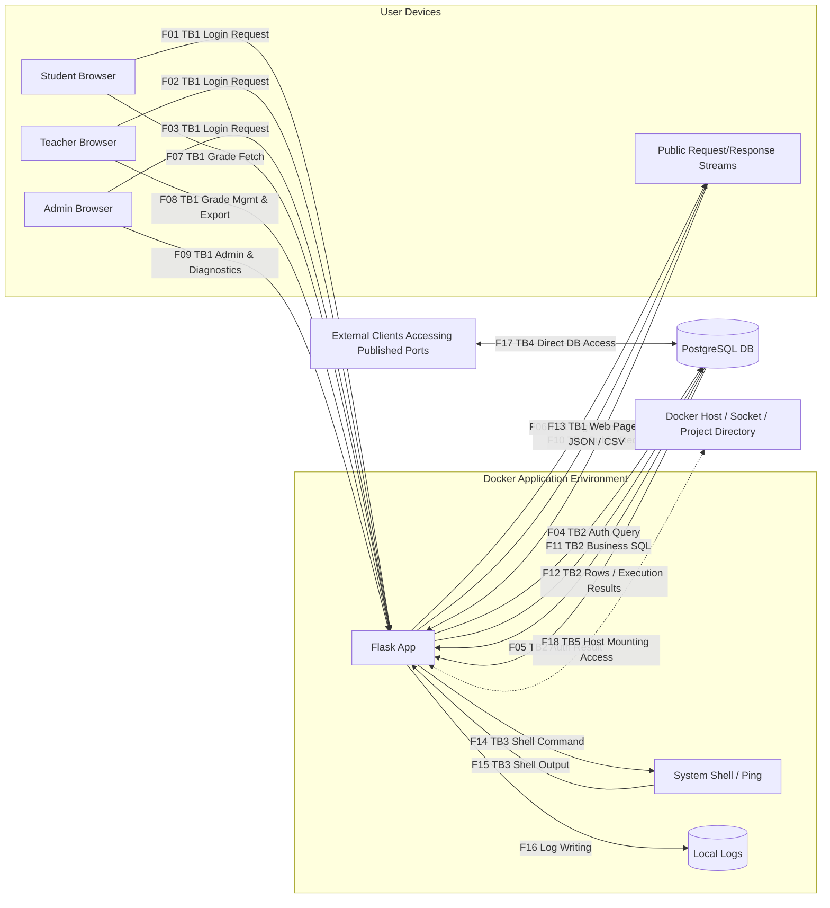
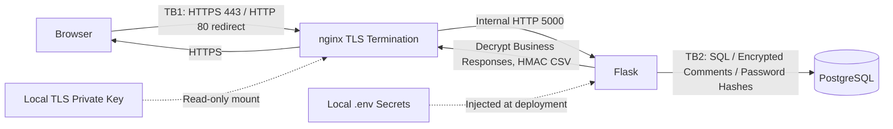

# Project 1 — NotesApp Threat Model and Risk Analysis

**Author:** CHEN YUCHEN (ENZO)  
**Student ID:** 2023905940  
**Analysis Date:** 2026-10-22  
**Notes:** Individual completion record. No fictitious team members or presentation claims.  
Based on Session 02 (pages 33–34) and Session 03 (page 31).  
The baseline application corresponds to the original fork commit `1c83e42`; post-course security refactoring changes are explicitly distinguished.  
This report is based on source code auditing, normal account testing, and isolated lab experiments; **it does not constitute proof of having successfully exploited all vulnerabilities.**

## 1. Assets and Roles

| Asset | Required Security Properties |
|---|---|
| Grades, teacher comments, student-class enrollments | Confidentiality, Integrity |
| Passwords, Session Cookies, JWTs, and Roles | Authenticity, Authorization Boundaries |
| PostgreSQL Database, Application, Docker Host | Availability, Least Privilege |
| Export files and operation logs | Integrity, Traceability |
| AES/HMAC Keys, TLS Private Keys | Confidentiality, Recoverability |

Students should only read their own grades; teachers should only manage their assigned classes; administrators manage users and classes.  
Code inspection reveals that the actual admin page only lists classes and lacks routes for adding, updating, or deleting classes; course slide role descriptions must not be mistaken for implemented features.  
External input is untrusted; holding a valid account does not grant authorization to access every record.

## 2. Numbered Data Flow Diagram (Baseline Application)

**TB1**: Identity/network boundary between user devices and application services.  
**TB2**: Credential, SQL, and authorization boundary between the app process and database service.  
**TB3**: Interpretation boundary where application data becomes shell parameters; does not imply the shell runs under a separate OS user.  
**TB4**: Boundary exposed to external network clients via Docker published host ports.  
**TB5**: Permission boundary between containers and the Docker host.  
F16 represents an intra-container persistent data flow where file permissions enforce access control, rather than forming a distinct network boundary.  
F17 is a bidirectional database protocol exchange; F18 is a potential channel provided by configuration—**Docker socket was not invoked during lab testing**.

## 3. Data Flow Inventory and Source Code Evidence

| ID | Sender → Receiver; Data Transferred | Code Location (Function name to avoid line drift) |
|---|---|---|
| F01 | Student → Flask; POST /login, username/password | `web/app.py:login` |
| F02 | Teacher → Flask; Same login form | `login` |
| F03 | Admin → Flask; Same login form | `login` |
| F04 | Flask → DB; SELECT Query concatenating username / baseline password | `login` |
| F05 | DB → Flask; User ID, username, role; new versions also read password hash | `login` |
| F06 | Flask → Browser; Login HTML, error or 302 with signed session Cookie; JWT inside session | `login`, `make_jwt` |
| F07 | Student → Flask; GET /dashboard, GET /api/notes/id, Cookie or Bearer JWT | `dashboard`, `api_notes` |
| F08 | Teacher → Flask; GET /teacher, GET /export.csv?class_id=…, POST /grades with ID/grade/comment | `teacher`, `export_csv`, `grades` |
| F09 | Admin → Flask; GET /admin, POST /admin/users fields, POST /admin/ping host | `admin`, `admin_users`, `admin_ping` |
| F10 | Browser → Flask; GET /, /login, /logout, /healthz, /static/style.css | `index`, `logout`, `healthz`, Flask static |
| F11 | Flask → DB; Grade/class/user queries, grade & user CRUD operations, DB health check | `get_db` and business functions |
| F12 | DB → Flask; Grades, comments, classes, user lists, execution results or exceptions | Same as F11 |
| F13 | Flask → Browser; Pages, role badges, plaintext JSON/CSV, errors & redirects; JWT in JS | Templates, `api_notes`, `export_csv` |
| F14 | Flask → Shell/Ping; Command constructed via host concatenation; ping sends ICMP | `admin_ping` |
| F15 | Shell/Ping → Flask; stdout, stderr, or timeout info, subsequently returned via F13 | `admin_ping` |
| F16 | Flask → Log file; Logins, grade operations, diagnostic logs | `log`, `web/Dockerfile` |
| F17 | Network Client ↔ DB; Port 5432 published by baseline compose, DB authentication & SQL | `docker-compose.yml:db.ports` |
| F18 | Flask Container ↔ Host; Docker socket API & project directory volume mounts | `docker-compose.yml:web.volumes` |

## 4. Initial STRIDE Matrix (Six Threat Categories Checked per Flow)

S = Spoofing, T = Tampering, R = Repudiation, I = Information Disclosure, D = Denial of Service, E = Elevation of Privilege.  
The table details potential threats; "No direct action" means the flow itself does not perform sensitive operations, not that the whole system is safe.

| Flow | S | T | R | I | D | E |
|---|---|---|---|---|---|---|
| F01 | Guess/steal student password | Modify login form fields | Insufficient login attribution | Password leak over plain HTTP | Resource exhaustion via no rate limit | Privilege escalation via weak token |
| F02 | Impersonate teacher | Modify login form fields | Teacher denies login event | Password/session leaked in transit | Resource overload via repeated logins | Gain teacher write privileges |
| F03 | Impersonate admin | Modify login form fields | Insufficient admin audit logging | Admin credential disclosure | Repeated authentication attempts | Gain administrator privileges |
| F04 | Overly broad shared DB identity | SQL injection alters query logic | Lack of independent DB audit | Exception reveals SQL query details | Expensive or malicious SQL queries | Querying outside authorization scope |
| F05 | Spoofed/compromised DB returns fake user | Role field tampered in DB response | No independent provenance of result | Identity fields leaked | DB non-response causes app timeout | Application accepts malicious role |
| F06 | Weak session secret enables forged identity | HTTP response modified in transit | Login logs modifiable | Cookie/JWT leaked in transit | Response block / connection drop | Forge arbitrary role session |
| F07 | API accepts unsigned JWT (`alg:none`) | Alter record ID parameter | Lacks per-record read auditing | API omits grade ownership check | Unpaginated / unthrottled requests | Student bypasses record authorization |
| F08 | Stolen teacher session | Arbitrary record ID write; missing CSRF | Logs lack old/new state values | Class-wide grade read and export | Resource exhaustion via large CSV/text | Unchecked teacher-course assignment |
| F09 | Stolen admin session | Admin form lacks CSRF | User management lacks audit log | User and course data leak | Repeated ping/admin requests | Host parameter command injection |
| F10 | Phishing site tricks user login | On-path CSS/page tampering | No independent audit for logout/health | `/healthz` reveals DB error details | Repeated health checks drain DB pool | Public flow grants no direct write access |
| F11 | Unsegregated DB user identity | DB role write scope too broad | Missing business-level DB auditing | Excessively wide query scope | DB connection / lock exhaustion | Lack of record/course scope limits |
| F12 | Compromised DB returns false records | Tamper with grades/comments | Results lack historical signatures | Plaintext grades/comments read | Large result set memory drain | Stored XSS via unescaped comment page |
| F13 | Fake response/CSV impersonates server | Unauthenticated CSV; unescaped comment | Export files lack proof of origin | Exposure of other students' grades; JWT in JS | Large payload exhausts client RAM | Stored XSS executes in user session |
| F14 | Executed via stolen admin identity | Host parameter injected into shell | Logs insufficient to audit command effect | Commands read local files/secrets | Subprocess & network thread exhaustion | Arbitrary command execution as root |
| F15 | Controlled subprocess returns fake output | Output content fabricated | Unsigned execution result | Output leaks sensitive system info | Large output consumes memory | Output is escaped text; no direct execution |
| F16 | Logs allow event actor forgery | File permissions permit tampering | Log deletion/tampering; missing change delta | Usernames/diagnostic data exposed | Unrotated log fills disk storage | Log file itself grants no direct privilege |
| F17 | Default DB credentials used to spoof user | Direct DB modification bypassing app | No app-level operation records | Direct retrieval of passwords & comments | SQL / Connection resource drain | Database initialization account overprivileged |
| F18 | Container spoofs trusted host client | Modify mounted project / manage containers | Host actions unmapped to business user | Host files / other container data leak | Control or shut down other containers | Docker socket bypasses container isolation |

## 5. Risk Scoring Matrix

Qualitative ranking for the **baseline application exposed under default compose settings** (not an empirical attack frequency statistic).  
**L (Likelihood)**: 1 = High prerequisite required, 2 = Requires account access / network reachability, 3 = Low barrier to entry.  
**I (Impact)**: 1 = Minor local effect, 2 = Single account / partial business impact, 3 = Mass sensitive data exposure / critical write access / host takeover.  
**R = L × I**: 1–2 Low, 3–4 Medium, 6–9 High. Equal scores prioritize attack chain entry points and impact radius.

| ID | STRIDE / Flow | Specific Threat | L | I | R | Mitigation Recommendation |
|---|---|---|---:|---:|---:|---|
| R01 | T/E, F04 | Login SQL injection alters query logic | 3 | 3 | 9 | Parameterize SQL, enforce DB least privilege |
| R02 | S/E, F06–07 | Unsigned JWT / weak secret enables identity forgery | 3 | 3 | 9 | Pin allowed algorithms, validate signature/exp, strong random secret |
| R03 | I/E, F07–08, F11–13 | API/Teacher endpoints lack resource ownership checks | 3 | 3 | 9 | Validate student/teacher relationship to course/record on every request |
| R04 | I/S, F01–06 | Plaintext HTTP sniffing of passwords and sessions | 2 | 3 | 6 | Enforce HTTPS, validate certs, close direct app ports |
| R05 | I, F12, F17 | Stolen database directly exposes cleartext passwords/comments | 2 | 3 | 6 | Argon2id for passwords, AES-GCM for comments, isolate keys from backups |
| R06 | T/E, F12–13 | Stored XSS via teacher comments | 2 | 3 | 6 | Enforce auto-escaping in templates, define rich text whitelist |
| R07 | T/E, F14, F18 | Admin command injection combined with host Docker socket | 2 | 3 | 6 | Avoid shell execution, sanitize inputs, remove socket mount, run as non-root |
| R08 | T, F08–09 | CSRF triggers unauthorized grade or user modifications | 2 | 3 | 6 | Implement CSRF tokens, check Origin header, apply secure Cookie policies |
| R09 | R, F16 | Tampered or missing logs make changes untraceable | 2 | 2 | 4 | Secure audit logging with actor, target, and before/after values |
| R10 | D, F01, F10–11, F16 | Auth, DB, export, or logging resource exhaustion | 2 | 2 | 4 | Implement rate limiting, payload caps, timeouts, pagination, log rotation |
| R11 | T/R, F13 | CSV recipient cannot verify file integrity/authenticity | 2 | 2 | 4 | Append HMAC with verification tool; digital signatures for public verification |
| R12 | I/T/E, F17 | Published DB port and default teaching credentials abused | 2 | 3 | 6 | Unpublish DB port, restrict network access, change default credentials |

### Top 3: Priority Remediations and Acceptance Criteria

1. **R01 SQL Injection**: Parameterize username queries; acceptance requires special characters to be treated as literals while valid logins work normally.  
   *Note: Class 5 explicitly deferred this fix to subsequent sessions; logged only, not fixed in advance.*
2. **R02 Identity Forgery**: Reject `alg:none`, strictly enforce signature, algorithm, and expiration checks; acceptance requires unsigned, expired, or invalidly signed tokens to be rejected.  
   *Note: Not fixed in current baseline; token forgery not executed during lab.*
3. **R03 Resource Access Control**: Enforce ownership checks on API, teacher lists, updates, and exports; acceptance requires isolation between roles/courses while legitimate access remains functional.  
   *Note: Not fixed in current baseline; student cross-record probing not executed in lab.*

## 6. Post-Course Security Boundaries and Residual Risks

| Security Control | Result | Limitations |
|---|---|---|
| AES-GCM Comments | 60 seed comments encrypted, AAD bound to record ID, tampering rejected | Grades and student names remain unencrypted; running app can still decrypt data |
| Export HMAC | Complete file validation passes; tampered content fails validation | File content remains cleartext; does not prevent replay of valid older files |
| HTTPS | Packet captures yield no cleartext test passwords; port 8080 no longer exposed | Self-signed certificate requires explicit local trust; internal HTTP relies on isolation |
| Argon2id | Alice login migrated, incorrect passwords fail migration, new users hashed directly | Un-logged-in legacy users remain cleartext; weak passwords still vulnerable to guessing |
| Lab Overlay Config | DB port unpublished, host socket unmounted, Nginx bound to loopback | Effective only when loading lab overlay files; baseline config preserved for teaching |

Secret files must never be committed to Git; runtime environments, host access, and key backups become additional assets requiring protection.  
The new controls do not resolve R01–R03 (reserved for subsequent course topics); this repository cannot be classified as production-ready.

## 7. Three-Minute Presentation Outline

- **0:00–0:40**: System roles and three primary asset types (grades, comments, credentials); clarify actual admin functionality limitations.
- **0:40–1:20**: Present numbered data flow diagram and TB1/TB2 boundaries; detail shell, direct DB, and host mount boundary implications.
- **1:20–2:15**: Explain STRIDE methodology and $L \times I$ scoring; highlight top 3 priority risks (SQL Injection, Token Forgery, Resource IDOR).
- **2:15–3:00**: Demonstrate experimental results for AES-GCM, HMAC, HTTPS, and Argon2id; state remaining unmitigated risks and self-signed TLS constraints.

*This outline is ready for presentation use; it does not claim that the classroom presentation has been completed.*